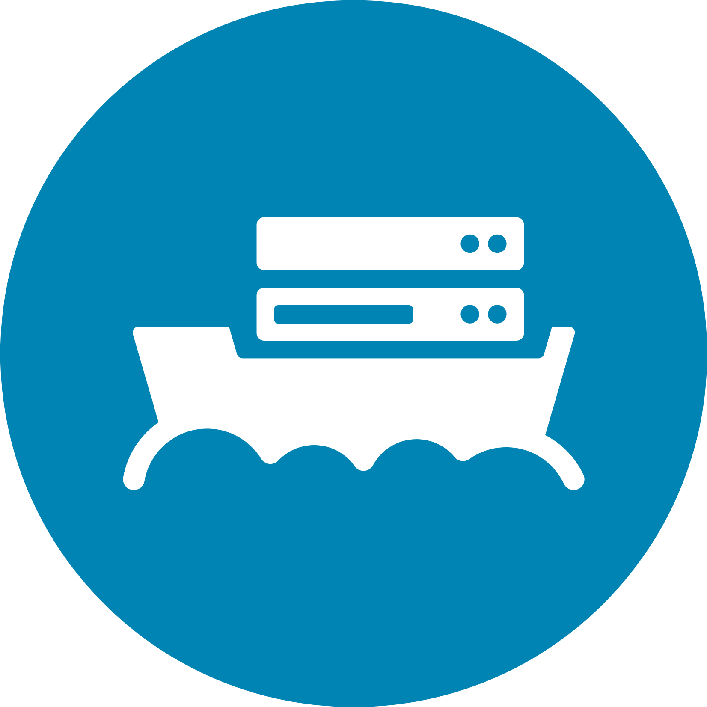

<picture>
  <source media="(prefers-color-scheme: dark)" srcset=".github/assets/stackship-logo-on-dark.svg">
  <source media="(prefers-color-scheme: light)" srcset=".github/assets/stackship-logo.svg">
  
</picture>

<h1>Stackship AI Chat</h1>

<strong>A private desktop chat for your organisation's own AI models.</strong> 
Your prompts stay on your machine. Your models run on your infrastructure.

  
  
  

  <a href="#why-stackship-ai-chat">Why</a> ·
  <a href="#features">Features</a> ·
  <a href="#getting-started">Getting started</a>

## Why Stackship AI Chat

Not every organisation can, or wants to, send its conversations to a public AI service. Stackship AI Chat gives your people a fast, familiar chat app that talks only to **your** AI gateway, running on your own Stackship platform.

You keep control of where data lives, which models are available, and what each person may spend.

## Features

<table>
  <tr>
    <td width="50%" valign="top">
      <h3>Private by design</h3>
      Conversations are never stored outside your computer. The app talks to your organisation's AI gateway and nothing else.
    </td>
    <td width="50%" valign="top">
      <h3>No keys to copy</h3>
      Sign in with your organisation's single sign-on, or type a short connection code. The app sets up the rest.
    </td>
  </tr>
  <tr>
    <td width="50%" valign="top">
      <h3>Credentials kept safe</h3>
      Your access is stored in your operating system's secure keychain, never in a plain file.
    </td>
    <td width="50%" valign="top">
      <h3>Budget at a glance</h3>
      See what you've spent against your limit, so there are no surprises at the end of the month.
    </td>
  </tr>
  <tr>
    <td width="50%" valign="top">
      <h3>Your models, your choice</h3>
      Every model your organisation makes available shows up in the app, ready to use.
    </td>
    <td width="50%" valign="top">
      <h3>Native and lightweight</h3>
      A small, fast desktop app that starts quickly and stays out of your way.
    </td>
  </tr>
</table>

## Getting started

1. **Install** the app from your organisation's download page.
2. **Connect** in one of two ways:
   - **Sign in** — select *Sign in*, complete sign-in in your browser, then confirm this computer.
   - **Connection code** — create a code in your organisation's AI portal and type it into the app.
3. **Chat.** Pick a model and start a conversation.

> [!NOTE]
> Your administrator decides which models and budgets are available to you. Ask them if a model you expect is missing.

  

Part of the <a href="https://stackship.se">Stackship</a> platform — the cloud experience, on your own infrastructure.

